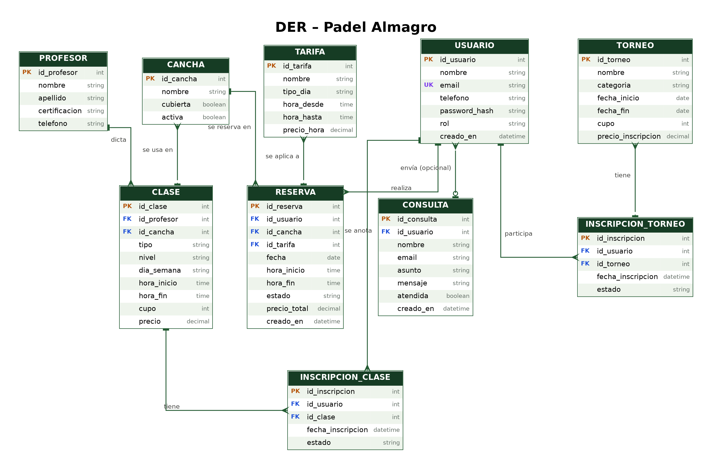

# Padel Almagro — Proyecto base didáctico

Proyecto inicial para **Seminario de Actualización en Tecnología Web — IFTS N.º 21**.

## Objetivo pedagógico

El proyecto está deliberadamente preparado para ser **leído, auditado y modificado**. Los comentarios de `index.html`, `styles.css` y `main.js` explican qué resuelve Bootstrap, qué corresponde al código personalizado y qué partes evolucionarán en los siguientes sprints.

## Stack inicial

- HTML5
- CSS3
- Bootstrap 5
- Bootstrap Icons
- JavaScript Vanilla
- Git + GitHub
- Netlify para la primera publicación estática

## Evolución prevista

La funcionalidad simulada en JavaScript se reemplazará progresivamente por peticiones `fetch()` a una API desarrollada con **FastAPI**. Luego se incorporará persistencia en base de datos y el proyecto completo se desplegará en un servicio que permita ejecutar backend.

```text
HTML + Bootstrap + CSS + JS
             ↓
           fetch()
             ↓
          FastAPI
             ↓
       Base de datos
```

## Estructura

```text
02-padel-almagro/
├── public/
│   ├── index.html
│   └── assets/
│       ├── css/styles.css
│       ├── js/main.js
│       └── img/favicon.svg
├── src/
│   └── routes/
│       └── __init__.py
├── main.py
├── requirements.txt
├── .env.example
├── .gitignore
└── README.md
```

## Etapa 1 — sitio estático

Abrir `public/index.html` en el navegador o utilizar Live Server. En esta etapa el objetivo es comprender la estructura existente, personalizarla y trabajar con Git mediante ramas y Pull Requests.

## Etapa posterior — FastAPI

Instalar dependencias:

```bash
pip install -r requirements.txt
```

Ejecutar:

```bash
uvicorn main:app --reload
```

FastAPI servirá el mismo frontend desde `public/`. Los endpoints se agregarán en `src/routes/` a medida que avance el proyecto.

> **Importante:** el código base no es una solución final. Las simulaciones y mensajes `PRÓXIMO PASO` están puestos intencionalmente para convertirse en tareas de sprint.
## Diagrama entidad-relación (DER)



### Entidades y relaciones

- **Profesor** dicta **Clase** (1 profesor, N clases).
- **Cancha** se usa en **Clase** y se reserva en **Reserva** (1 cancha, N clases y N reservas).
- **Tarifa** se aplica a **Reserva** (1 tarifa, N reservas).
- **Usuario** realiza **Reserva** (1 usuario, N reservas).
- **Usuario** envía **Consulta**, de forma opcional (una consulta puede no tener usuario).
- **Usuario** se anota a **Clase** mediante **Inscripción de clase** (relación N a N).
- **Usuario** participa en **Torneo** mediante **Inscripción de torneo** (relación N a N).

El script SQL que implementa este diagrama está en `db/schema.sql`, y los datos de prueba en `db/seed.sql`.